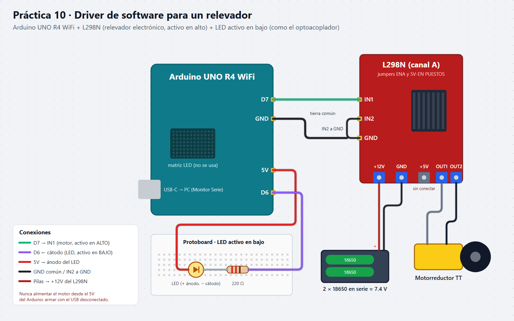
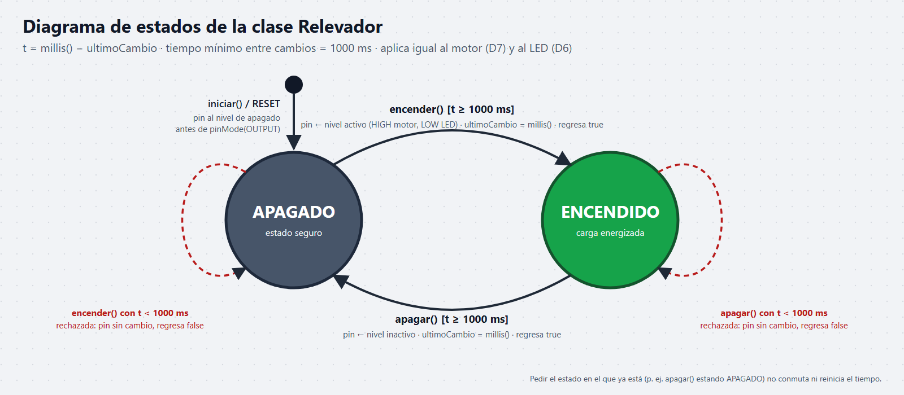
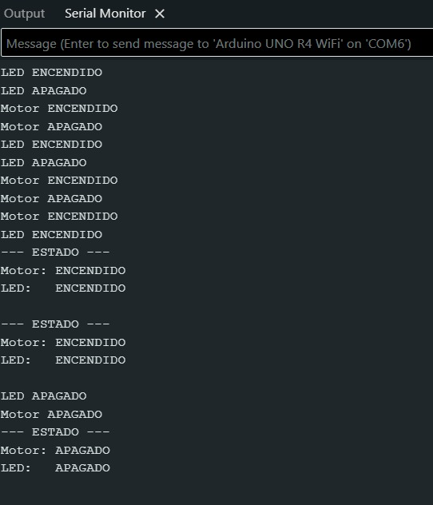

# Nombre del proyecto
Driver de software para un relevador

## Descripción
Una clase de C++ (`Relevador`) modela un relevador: guarda su estado, traduce
"encender" y "apagar" al nivel de pin correcto y hace cumplir sus reglas de
seguridad. La misma clase controla dos actuadores desde el Monitor Serie: un
motorreductor a través del L298N (activo en alto) y un LED que imita al
optoacoplador de un módulo de relevador (activo en bajo).

## Objetivos
- Encapsular el estado, las órdenes y las restricciones de un actuador en una
  clase, sin `digitalWrite()` en el programa principal.
- Resolver dentro del software la lógica activo en alto / activo en bajo.
- Rechazar cambios con menos de 1000 ms entre sí y arrancar siempre en estado
  seguro (apagado), sin usar `delay()`.
- Separar la parte de señal (Arduino) de la de potencia (pilas del motor).

## Herramientas y material utilizado
- Arduino UNO R4 WiFi y cable USB-C
- Módulo puente H L298N y motorreductor DC tipo TT
- 2 pilas 18650 en serie (≈ 7.4 V) para el motor
- LED y resistencia de 220 Ω, protoboard y jumpers
- Arduino IDE y Monitor Serie (9600 baudios)

## Diagrama
D7 → IN1 del L298N (IN2 a GND, jumpers de ENA y 5V-EN puestos), pilas a
+12V/GND del L298N con tierra común al Arduino, motor en OUT1/OUT2. LED: 5V →
ánodo, cátodo → 220 Ω → D6.

## Código
`DriverRelevador.ino` (código del equipo): la clase `Relevador` con
`iniciar()`, `encender()`, `apagar()`, `estaEncendido()` y `faltaMs()`; dos
objetos, `motor(7, activo en alto)` y `led(6, activo en bajo)`. Comandos
`M1`/`M0`, `L1`/`L0` y `E` por el Monitor Serie (9600, "Nueva línea"); las
órdenes que llegan antes de 1 s se rechazan sin tocar el pin.
Detalles en [Codigo/Readme.txt](Codigo/Readme.txt).

[Ver código](Codigo/)

## Reporte
Metodología (clase, traducción del nivel, tiempo mínimo, estado seguro y
comandos), diagrama de estados, conexiones, pruebas de seguridad, prueba de
inversión, las 6 preguntas de reflexión y conclusiones.

[Ver Reporte](Reporte/Reporte-Driver-Relevador.pdf)

## Resultados
Los comandos respondieron en físico: `L1`/`L0` encendieron y apagaron el LED,
`M1`/`M0` el motorreductor, y `E` reportó el estado de ambos de acuerdo con la
última orden ("Motor: ENCENDIDO / LED: ENCENDIDO" y, tras apagarlos, los dos
APAGADO). En el video, los cables del motor se sostienen con la mano porque
no quedaron fijos en la clema del L298N.
En la captura no aparece ninguna orden rechazada por el tiempo mínimo de 1 s.

## Video
El video muestra el código, el Monitor Serie y el LED y el motor respondiendo
a los comandos.

[Ver video](https://youtube.com/shorts/bL3LOrrr8CQ) · [Ver carpeta Video](Video/)

## Conclusiones
Con el relevador modelado como clase, el programa habla con órdenes que
tienen significado y no con niveles de pin. Un solo parámetro bastó para
controlar un actuador activo en alto y otro activo en bajo, y las reglas
físicas (tiempo mínimo y estado seguro) viven dentro del modelo, donde nadie
se las puede saltar.
