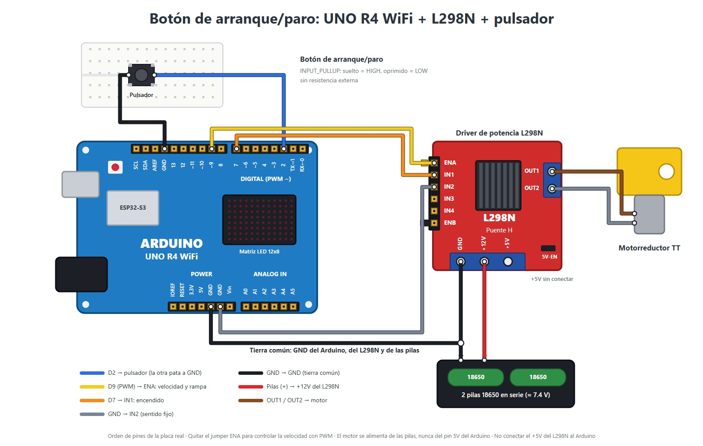
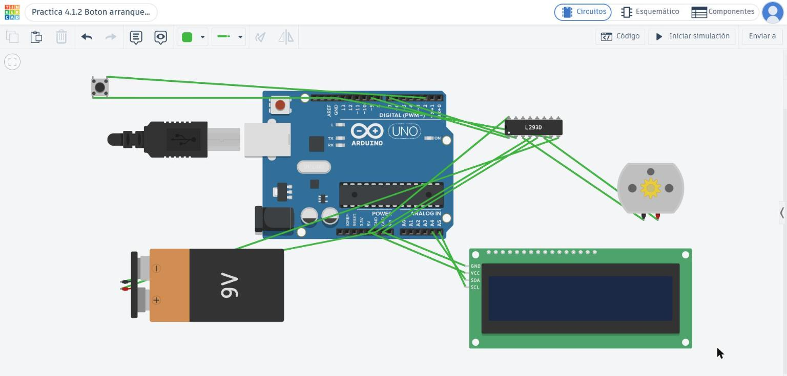
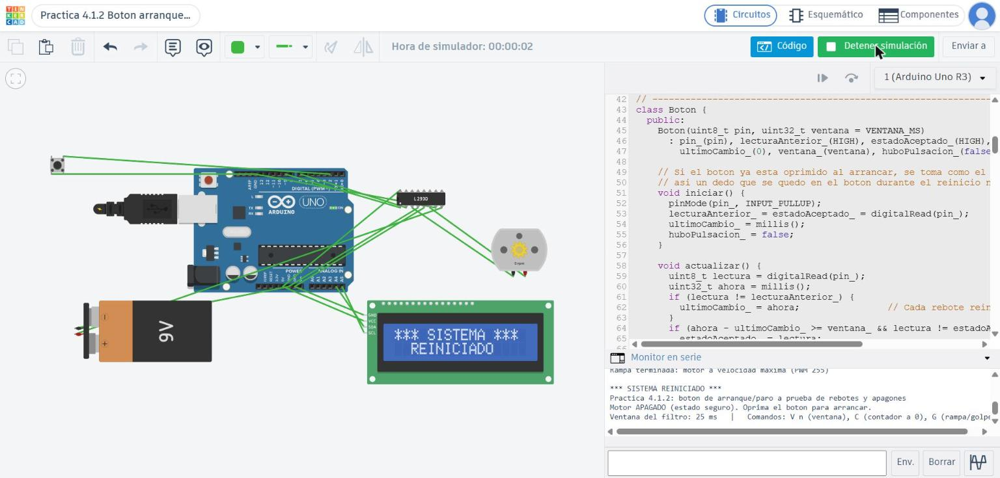

# Nombre del proyecto
Control de arranque y paro con un botón, protegido contra rebotes y cortes de energía

## Descripción

El objetivo de esta práctica (4.1.2) fue controlar un motor usando un único botón: al presionarlo una vez el motor se enciende y al presionarlo de nuevo se apaga. El programa está pensado para resistir dos problemas que ocurren en el mundo real. Por un lado, los contactos del botón rebotan, y el Arduino puede interpretar varias pulsaciones cuando el usuario solo presionó una. Por otro lado, una caída de voltaje puede reiniciar la placa y provocar que la máquina haga algo sin que nadie lo pida.

Para el rebote se implementó, dentro de la clase `Boton`, un filtro que no detiene el programa. Un cambio en la señal solo se acepta si permanece estable durante 25 ms (tiempo medido con `millis()`), y la pulsación solo se registra en la transición de suelto a presionado. Para los cortes de energía, lo primero que hace `setup()` es apagar el motor; después muestra un aviso de reinicio en la matriz LED y en el Monitor Serie, y el motor no vuelve a encender hasta que se presione el botón otra vez. Como extra, el encendido se hace con una rampa de PWM de 1.5 s para reducir la corriente de arranque, mientras que el apagado es instantáneo.

Al no tener el Arduino físico disponible, el circuito se montó y se probó en Tinkercad. Ahí no existen el UNO R4 WiFi ni el módulo L298N, por lo que se sustituyeron por un UNO R3 y el circuito integrado L293D (también es un puente H y se maneja de la misma forma), además de una LCD 16x2 en vez de la matriz LED. La lógica del programa es idéntica en ambas versiones; lo único que cambia es el código de la pantalla.

## Objetivos

* Reconocer fenómenos físicos que afectan el funcionamiento de un sistema programable, como el rebote mecánico y las caídas de voltaje.
* Programar un filtro antirrebote que no bloquee el programa, usando `millis()` en lugar de `delay()`.
* Detectar el flanco de bajada de la señal del botón (cuando pasa de suelto a presionado).
* Diseñar un encendido seguro, de modo que tras un reinicio el sistema no ejecute acciones que nadie solicitó.
* Usar una rampa de PWM al arrancar para disminuir el pico de corriente del motor.

## Herramientas y material utilizado

### Hardware (montaje físico)

* Arduino UNO R4 WiFi con su cable USB-C
* Módulo puente H L298N
* Motorreductor de CD (tipo TT, 3–6 V)
* Dos baterías 18650 en portapilas conectadas en serie (≈ 7.4 V)
* Botón pulsador
* Protoboard
* Cables jumper macho-macho y macho-hembra

### Simulación (Tinkercad)

* Arduino UNO R3
* Circuito integrado puente H L293D
* Motor de CD
* Batería de 9 V
* Botón pulsador
* LCD 16x2 con módulo I2C (sustituye a la matriz LED)

### Software

* Arduino IDE
* Monitor Serie
* Tinkercad

## Diagrama

### Conexiones

El Arduino únicamente envía las señales de control; la energía que mueve el motor proviene de las baterías y el L298N se encarga de conmutarla.

| Etapa de potencia (motor) | Conexión |
| ------------------------- | -------- |
| Positivo del portapilas   | +12V del L298N |
| Negativo del portapilas   | GND del L298N |
| GND del L298N             | GND del Arduino (tierra compartida, indispensable) |
| Motorreductor             | OUT1 y OUT2 |
| Jumper 5V-EN              | Colocado |
| Jumper ENA                | Retirado, para regular la velocidad por PWM |
| +5V del L298N             | Libre |

| Etapa de control | Conexión |
| ---------------- | -------- |
| D9 del Arduino   | ENA del L298N (PWM para la rampa de velocidad) |
| D7 del Arduino   | IN1 del L298N (encendido) |
| IN2 del L298N    | GND (giro en un solo sentido) |
| Pulsador         | Un extremo a D2 y el contrario a GND (sin resistencia, gracias a `INPUT_PULLUP`) |

### Circuito en Tinkercad

| Tinkercad (UNO R3)         | Su equivalente en el montaje físico |
| -------------------------- | ----------------------------------- |
| D9 → pin 1 del L293D (EN1,2) | D9 → ENA |
| D7 → pin 2 (IN1)           | D7 → IN1 |
| Pin 7 (IN2) → GND          | IN2 → GND |
| Pines 3 y 6 (OUT1, OUT2) → motor | OUT1 y OUT2 → motor |
| Pin 8 (VCC2) → batería de 9 V | +12V → baterías 18650 |
| Pin 16 (VCC1) → 5V         | (en el L298N esto lo cubre el jumper 5V-EN) |
| Pines 4 y 5 → GND          | GND del L298N → GND |
| LCD: SDA → A4, SCL → A5, VCC → 5V, GND → GND | Matriz LED de la placa |
| Pulsador entre D2 y GND    | Pulsador entre D2 y GND |

[Ver carpeta Diagrama](Diagrama/)

## Código

### Clase `Boton`

Todo el filtro antirrebote está encapsulado en la clase `Boton`, de forma que pueda reutilizarse con cualquier pulsador en prácticas futuras. Como atributos privados almacena el pin, la última lectura, el estado ya validado, el momento del último cambio, la ventana de estabilidad (25 ms) y una bandera que indica si hubo pulsación.

| Método | Función |
| ------ | ------- |
| `iniciar()` | Configura el pin como `INPUT_PULLUP` y toma la lectura del momento como estado inicial |
| `actualizar()` | Se ejecuta en cada ciclo del `loop()`. Si la lectura cambió, vuelve a poner en cero el cronómetro; si ya pasaron 25 ms sin cambios y la lectura difiere del estado validado, la acepta. Si el nuevo estado es `LOW` (presionado), activa la bandera |
| `fuePresionado()` | Devuelve `true` una única vez por cada pulsación real y limpia la bandera |

Como cada rebote vuelve a arrancar el cronómetro, un rebote de entre 1 y 10 ms nunca alcanza los 25 ms y queda descartado. La bandera solo se activa cuando el estado validado cambia a `LOW`, así que al soltar el botón no se cuenta nada. En `iniciar()` el estado inicial se toma de la lectura real del pin: si el botón estaba presionado mientras la placa se reiniciaba, no se interpreta como una pulsación nueva y el motor no se enciende por sí solo.

### Motor y encendido seguro

* **Lo primero en `setup()`:** PWM en 0 e IN1 en `LOW`, antes de inicializar cualquier otra cosa.
* **Aviso de reinicio:** durante 3 s la matriz LED muestra "RST" y el Monitor Serie imprime `*** SISTEMA REINICIADO ***`. Luego la matriz cambia a "ON" u "OFF", con una barra de velocidad en la fila inferior.
* **Rampa:** al encender, el PWM aumenta de 0 a 255 en 1.5 s, de forma proporcional al tiempo transcurrido (medido con `millis()`) desde que comenzó la rampa.
* **Paro:** instantáneo, con PWM en 0 e IN1 en `LOW`.
* El código no utiliza `delay()`: en cada ciclo del `loop()` se actualizan el botón, la rampa, la pantalla y el Monitor Serie.

### Comandos por Monitor Serie (115200 baudios)

| Comando | Efecto |
| ------- | ------ |
| `V n`   | Ajusta la ventana del filtro a n ms (permite probar 2, 25 y 300 ms sin recargar el programa) |
| `C`     | Reinicia a 0 el contador de pulsaciones |
| `G`     | Cambia entre arranque con rampa y arranque directo (PWM a 255 de inmediato) para comparar ambos |

### Archivos

* `Boton_Arranque_Paro`: versión definitiva para el UNO R4 WiFi (con matriz LED).
* `Boton_Sin_Filtro`: versión intermedia (paso 2 del desarrollo) que cuenta todos los flancos sin filtrarlos.
* `Boton_Arranque_Paro_Tinkercad`: la versión definitiva adaptada al UNO R3 de Tinkercad, usando la LCD I2C en vez de la matriz.

[Ver código Boton_Arranque_Paro.ino](Codigo/Boton_Arranque_Paro/Boton_Arranque_Paro.ino)

[Ver carpeta Código](Codigo/)

## Pruebas

1. **Encendido seguro:** al arrancar la placa, el motor debe quedar detenido y mostrarse el aviso de reinicio.
2. **Arranque y paro:** con una pulsación el motor arranca con rampa y con la siguiente se detiene al instante.
3. **Simulación de apagón:** con el motor en marcha se interrumpe la alimentación (en Tinkercad, deteniendo y volviendo a iniciar la simulación). Al regresar, el motor debe estar apagado, aparecer el aviso y encender únicamente con una pulsación nueva.
4. **Rampa vs. arranque directo:** con `G` se comparan ambos tipos de arranque.
5. **Ventana del filtro:** se repite la misma pulsación breve con `V 300` y con `V 25`.
6. **Prueba de rebote:** presionar el botón 10 veces, con calma, primero en la versión sin filtro y luego en la versión con filtro.

## Resultados

Todas las pruebas se realizaron en la simulación de Tinkercad, usando el mismo programa adaptado al UNO R3.

* **Encendido seguro:** al arrancar, la LCD mostró "SISTEMA REINICIADO", en el Monitor Serie apareció `*** SISTEMA REINICIADO ***` y el motor permaneció en 0 rpm. Pasados 3 s, la LCD cambió a "Motor: OFF".
* **Arranque con rampa:** con la primera pulsación la LCD indicó "Motor: RAMPA" y la barra fue creciendo conforme el motor ganaba velocidad. Al completarse, el Monitor Serie mostró `Rampa terminada: motor a velocidad maxima (PWM 255)` y la LCD pasó a "Motor: ON".
* **Paro:** con la pulsación siguiente el motor se detuvo al instante y la LCD regresó a "Motor: OFF".
* **Apagón:** con el motor en marcha se detuvo la simulación y se inició de nuevo. El sistema volvió en estado seguro, con el aviso de reinicio y el motor detenido, y el contador volvió a comenzar en `Pulsacion #1` únicamente al presionar de nuevo el botón.
* **Arranque directo:** con `G` el motor llegó de inmediato a su velocidad máxima ("Motor: ON" sin mostrar "RAMPA").
* **Ventana:** con `V 300` una pulsación breve no fue registrada; con `V 25` esa misma pulsación sí se registró (`Pulsacion #4`).

### Limitaciones de la simulación

**En Tinkercad no es posible realizar la prueba de rebote.** El pulsador del simulador es ideal: cambia de estado una sola vez y no tiene una lámina metálica que rebote. Por eso, en la simulación la versión sin filtro y la versión con filtro cuentan exactamente lo mismo, y las columnas de pulsaciones contadas no se pueden llenar con datos reales.

Además, al tener activos la LCD I2C y el motor, Tinkercad se ejecuta mucho más lento que el tiempo real; en una prueba avanzó apenas 3.4 s de simulación en 134 s reales. Debido a esto, al intentar contar 10 pulsaciones seguidas algunas se perdían por culpa del simulador y no del filtro, así que esos conteos no se consideraron como resultados.

La tabla de la práctica queda pendiente hasta contar con un botón físico:

| Prueba | Pulsaciones reales | Pulsaciones contadas | Veces que el motor no respondió |
| ------ | ------------------ | -------------------- | ------------------------------- |
| Sin filtro, intento 1 | 10 | Pendiente (botón físico) | Pendiente |
| Sin filtro, intento 2 | 10 | Pendiente (botón físico) | Pendiente |
| Sin filtro, intento 3 | 10 | Pendiente (botón físico) | Pendiente |
| Ventana 2 ms   | 10 | Pendiente (botón físico) | Pendiente |
| Ventana 25 ms  | 10 | Pendiente (botón físico) | Pendiente |
| Ventana 300 ms | 10 | Pendiente (botón físico) | Pendiente |

## Preguntas de reflexión

**1. Explica con tus palabras qué es el rebote y por qué el Arduino lo detecta aunque tú no lo notes.**

El botón tiene en su interior una pequeña lámina metálica que, al presionarse, golpea los contactos y rebota algunas veces antes de quedar fija, parecido a una pelota que se deja caer. Esto ocurre en muy pocos milisegundos (entre 1 y 10 ms), por lo que la persona percibe un solo clic. Sin embargo, el Arduino revisa el pin miles de veces por segundo, así que detecta cada separación de la lámina como un cambio en la señal: presionado, suelto, presionado, suelto… y lo interpreta como varias pulsaciones.

**2. ¿Por qué el contador debe sumar solo al pasar de suelto a oprimido y no en cualquier cambio de la señal?**

Porque una pulsación completa genera dos cambios: uno al presionar (de `HIGH` a `LOW`) y otro al soltar (de `LOW` a `HIGH`). Si se contara cualquier cambio, cada pulsación sumaría 2 aun sin rebotes, y el motor se encendería y apagaría con un solo clic. Al contar únicamente la transición de suelto a presionado, cada pulsación vale exactamente 1.

**3. ¿Por qué el rebote al soltar el botón también puede sumar pulsaciones?**

Porque al soltar, la lámina también rebota antes de separarse por completo, y la señal queda como `HIGH`, `LOW`, `HIGH`. Esa caída falsa a `LOW` parece una transición de suelto a presionado, de modo que un programa sin filtro la registra como otra pulsación aunque el usuario en realidad estaba soltando el botón. El filtro lo impide porque ese `LOW` dura menos de 25 ms y nunca llega a validarse.

**4. ¿Qué problema tendría usar `delay(50)` para filtrar el rebote en lugar de `millis()`?**

`delay()` pausa por completo la ejecución mientras espera. En esos 50 ms el Arduino no puede avanzar la rampa del motor, refrescar la pantalla, atender el Monitor Serie ni leer otras entradas, así que el sistema se "traba" un instante con cada pulsación. Además, `delay(50)` no es un filtro real: solo espera un tiempo fijo tras el primer cambio sin verificar que la señal se haya estabilizado, por lo que un rebote que aparezca después de la espera (como al soltar) se sigue contando. Con `millis()` el programa solo registra el momento y continúa trabajando, y acepta el cambio hasta que la señal lleva el tiempo completo sin variar.

**5. Según tus pruebas, ¿qué pasa si la ventana de estabilidad es muy corta? ¿Y si es muy larga?**

Si la ventana es demasiado larga (300 ms), las pulsaciones rápidas se pierden: en la simulación, una pulsación breve no se registró con `V 300`, pero la misma sí se registró con `V 25`. Además, el botón se percibe lento porque el sistema tarda en responder. Si la ventana es demasiado corta (2 ms), no se puede comprobar en Tinkercad porque su botón no rebota; con un botón físico lo esperado es que algunos rebotes pasen el filtro, ya que duran de 1 a 10 ms y muchos superan los 2 ms. Por eso 25 ms resulta un buen equilibrio: supera la duración de cualquier rebote y es mucho menor que una pulsación humana.

**6. ¿Por qué es peligroso que un sistema reinicie con el motor encendido? Da un ejemplo industrial.**

Porque al regresar la energía la máquina podría ponerse en marcha sola, sin que nadie lo indicara, justo cuando alguien la está inspeccionando o tiene las manos cerca. Por ejemplo, en una banda transportadora, una sierra o una prensa, tras un parpadeo de luz un operador podría acercarse a liberar una pieza atorada; si la máquina reanuda su movimiento al volver la energía, podría herirlo. Por esta razón, en la industria se exige que el operador presione de nuevo el botón de arranque después de cualquier corte.

**7. ¿Por qué la rampa de arranque ayuda a evitar caídas de voltaje?**

Un motor detenido consume mucha más corriente al arrancar que cuando ya está girando, porque aún no genera la fuerza contraelectromotriz que limita esa corriente. Si el PWM salta de 0 a 255 de golpe, el motor demanda todo ese pico al mismo tiempo, la fuente no logra entregarlo y el voltaje cae, lo que puede reiniciar el Arduino. Con la rampa, el voltaje promedio aplicado al motor aumenta de forma gradual, el motor acelera conforme sube la corriente y el pico resulta mucho más pequeño.

**8. Menciona dos medidas de hardware que ayudan a evitar caídas de voltaje y que el software no puede reemplazar.**

* **Usar una fuente independiente y con capacidad suficiente para el motor** (las baterías 18650 o una fuente con la corriente necesaria), nunca el pin de 5V del Arduino, y siempre con las tierras conectadas entre sí.
* **Agregar un capacitor electrolítico** (de 470 a 1000 µF, por ejemplo) cerca de la alimentación del driver, que aporta la corriente del pico de arranque y suaviza la caída.

También son útiles los cables cortos y de buen calibre y las conexiones bien firmes, ya que los cables delgados o sueltos y los falsos contactos de la protoboard generan caídas de voltaje que ningún programa puede compensar.

## Reporte

El reporte describe el filtro antirrebote de la clase `Boton`, la detección del flanco de bajada, el encendido seguro, la rampa de PWM y las pruebas hechas en la simulación, además de incluir las respuestas a las preguntas de reflexión.

[Ver reporte](Reporte/Reporte-Boton-Arranque-Paro.pdf)

## Video

En el video se puede ver el circuito en Tinkercad, el encendido seguro con su aviso de reinicio, el arranque con rampa, el paro instantáneo, la prueba de apagón, la comparación entre arranque directo y con rampa, y la prueba de la ventana del filtro.

[Ver video de la práctica](https://youtu.be/QTUOvEkSXTw)

[Ver carpeta Video](Video/)

## Conclusiones

Con esta práctica quedó claro que un programa que funciona "en papel" puede fallar al enfrentarse al mundo físico: el botón no cambia de estado una sola vez sino que rebota, y el voltaje no siempre se mantiene estable. El primer problema se resolvió por software con el filtro antirrebote, sin detener la ejecución: la idea es no confiar en la señal hasta que permanezca estable cierto tiempo y contar únicamente la transición de suelto a presionado.

También se entendió por qué es importante el encendido seguro. Un reinicio no es peligroso en sí mismo; el riesgo está en que el sistema ejecute algo que nadie ordenó al volver. Apagar el motor como primera instrucción, avisar que hubo un reinicio y esperar una orden nueva vuelve al sistema predecible.

Por último, la simulación sirvió para verificar el encendido seguro, la rampa, el paro y el efecto de la ventana del filtro, aunque también dejó ver sus limitaciones: el botón de Tinkercad no rebota y el simulador se vuelve lento con la pantalla, por lo que medir el rebote requiere un botón físico. El software es de gran ayuda, pero no sustituye una alimentación adecuada ni unas buenas conexiones.
